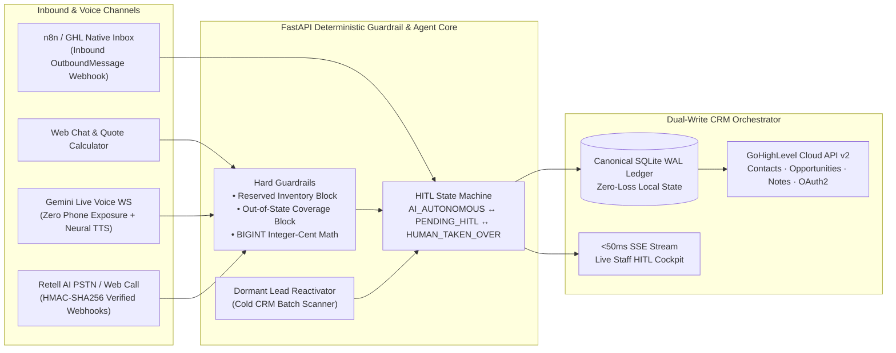

# GoHighLevel API v2, Dual Voice AI & HITL Receptionist Concierge (`ghl-voice-ai-crm-concierge`)

Production-grade reference architecture for **SMB & B2B AI Receptionists** combining **GoHighLevel (`GHL`) API v2** two-way synchronization, **Dual Voice AI Providers** (`Gemini Live` WebSocket + `Retell AI` PSTN/Web Call with `HMAC-SHA256` signature verification), **Human-In-The-Loop (`HITL`) staff takeover switches**, and **deterministic integer-cent (`BIGINT`) financial guardrails**.

> **Demo Vertical Included (`Horizon Estates`)**: Configured out-of-the-box with a neutral California real-estate seller-financing catalog (`Apple Valley`, `Victorville`, `Hesperia`, `Phelan`) to exercise multi-turn voice tool-calling, `CA Penal Code § 632` two-party recording disclosure at `t=0s`, below-minimum price negotiation escalation, reserved-inventory hard blocks, and dormant lead reactivation—all **without exposing real phone numbers or external credentials** in `SANDBOX_PREVIEW` mode.

---

## Architecture Overview



---

## Key Production Engineering Capabilities

1. **Zero-Data-Loss Dual-Write GoHighLevel API v2 Adapter (`app/adapters/crm.py`)**
   - Writes first to a local **SQLite `WAL` canonical ledger** (`contacts`, `messages`, `hitl_requests`, `voice_calls`, `crm_sync_events`), then upserts **Contacts**, **Contact Notes**, **Pipeline Opportunities**, and **State Tags** (`ai-autonomous`, `pending-hitl`, `human-takeover`, `ai-paused`) against `https://services.leadconnectorhq.com` (`Version: 2021-07-28`).
   - Supports both **OAuth 2.0 Sub-Account App Installation** (`/api/v1/ghl/oauth/authorize` & `/callback`) and **Private Integration Tokens (`PIT`)**, plus a zero-credential `SANDBOX_PREVIEW` mode that captures inspectable GHL v2 payloads locally.

2. **Bidirectional Human-In-The-Loop (`HITL`) Takeover & Bot-Silencing (`app/services/concierge.py`, `app/main.py`)**
   - **Automatic Escalation (`PENDING_HITL`)**: When a prospect requests a discount or down payment below policy thresholds, the AI refuses to hallucinate concessions, moves the GHL Opportunity to the `PENDING_HITL_APPROVAL` stage, and alerts human staff via `<50ms` Server-Sent Events (`SSE`).
   - **Native GHL Inbox Auto-Lock (`POST /api/v1/webhooks/ghl/inbound`)**: If a human receptionist or sales closer replies manually from the GoHighLevel mobile/web app (`type == "OutboundMessage"` with `userId`), the webhook immediately transitions the contact to `HUMAN_TAKEN_OVER`, applies the `human-takeover` tag, and **100% silences the AI** on subsequent turns until explicitly released (`RELEASE_TO_AI`).

3. **Dual Voice AI Strategy (`app/adapters/voice.py`)**
   - **Strategy A — `Gemini Live` Browser WebSocket (`/api/v1/voice/gemini-live/ws`)**: Plays mandatory **California Penal Code § 632** two-party recording consent at `t=0s`, processes live audio/text turns with grounded Gemini Function Calling (`list_available_lots`, `calculate_financing_plan`, `request_hitl_sales_exception`, `book_land_consultation`), and syncs call summaries + transcripts to GoHighLevel on hangup—with **zero PSTN phone exposure**.
   - **Strategy B — `Retell AI` Adapter (`/api/v1/voice/retell/webhook`)**: Verifies `X-Retell-Signature` via constant-time `HMAC-SHA256` before ingesting `call_analyzed` transcripts, recording URLs, and dynamic variables into GoHighLevel.

4. **Exact Integer-Cent (`BIGINT`) Financial Calculations (`app/domain.py`)**
   - All principal, down-payment, and amortization calculations run in integer cents and basis points (`Decimal` with `ROUND_HALF_UP`)—eliminating IEEE-754 floating-point drift across quotes, CRM `monetaryValue` fields, and downstream accounting ledgers (e.g., QuickBooks / Stripe).

5. **Plug-and-Play `n8n` & SMB Vertical Portability**
   - While seeded with a real-estate dataset (`Horizon Estates`), the exact webhook and state-machine contracts map directly to **Veterinary & Dental Clinics** (missed-call SMS recovery, appointment triage, front-desk `HITL` takeover) and **Accounting Firms** (client intake qualification, cent-exact fee quotes, QuickBooks/CRM idempotency).
   - Every endpoint (`POST /api/v1/webhooks/ghl/inbound`, `POST /api/v1/voice/retell/webhook`, `POST /api/v1/hitl/action`, `POST /api/v1/reactivation/run`) is designed to be triggered directly from **n8n HTTP Request / Webhook workflows**.

---

## Quickstart

### 1. Install Dependencies (`Python 3.12+` / `uv`)

```bash
git clone https://github.com/jmoralespestana/ghl-voice-ai-crm-concierge.git
cd ghl-voice-ai-crm-concierge
cp .env.example .env
uv sync --all-groups
```

### 2. Run the Automated Test Suite (`Zero External Keys Required`)

```bash
uv run pytest -v
```

The test suite exercises:
- Spanish TTS currency/number/statute normalization (`$771.60 USD/mes` -> spoken words)
- Executive PIN gate authentication (`401` vs `200`)
- Exact `BIGINT` cents amortization & reserved-lot blocking (`LOT-PH-04`)
- Out-of-state coverage guardrails (`Colorado` -> honest California-only disclosure)
- Below-minimum negotiation -> `PENDING_HITL` -> Manager 1-click approval -> `SHOWING_BOOKED`
- `HUMAN_TAKEN_OVER` bot silencing + `RELEASE_TO_AI` resumption
- Live GoHighLevel API v2 `contacts/upsert`, `notes`, and `opportunities/upsert` via `httpx.MockTransport`
- Gemini Live WebSocket (`CA § 632` greeting + spoken quote + post-call sync) & Retell `HMAC-SHA256` signature enforcement (`401` on forged signature, `200` on valid HMAC)
- Inbound GoHighLevel `OutboundMessage` webhook auto-locking human takeover & dormant lead batch reactivation

### 3. Launch the Dual-View Interactive UI (Buyer Portal + Staff HITL Cockpit)

```bash
./scripts/start_local_demo.sh
```

Open `http://localhost:8090` to switch in real time between:
- **Buyer View**: Interactive payment calculator, 1-click guardrail test pills, omnichannel chat, and live WebSocket voice call drawer.
- **Director / Staff HITL Cockpit**: Live Kanban pipeline, 1-click exception approval / human takeover controls, dormant-lead batch reactivator, and real-time GoHighLevel API v2 Dual-Write inspector.

---

## Repository Structure

```text
├── app/
│   ├── adapters/
│   │   ├── crm.py          # Dual-Write SQLite WAL + GoHighLevel API v2 (OAuth2 & PIT)
│   │   └── voice.py        # Gemini Live WS + Retell AI HMAC-SHA256 Voice Adapters
│   ├── services/
│   │   └── concierge.py    # Deterministic Guardrails, HITL State Machine & Reactivator
│   ├── static/             # Dual-View Buyer Portal + Staff HITL Kanban Cockpit UI
│   ├── config.py           # Typed Pydantic Settings (.env driven, zero hardcoded secrets)
│   ├── db.py               # SQLite WAL schema & idempotent ledger helpers
│   ├── domain.py           # BIGINT integer-cent amortization & catalog models
│   ├── events.py           # Async in-memory SSE broadcaster (<50ms UI updates)
│   └── main.py             # FastAPI REST, Webhooks, OAuth2, SSE & WebSocket routes
├── scripts/
│   ├── start_local_demo.sh     # Preflight check & local uvicorn launcher
│   ├── share_demo_with_pin.sh  # PIN-gated launcher for live screen-share / tunnel sessions
│   └── verify_demo_runbook.py  # 13-check end-to-end live integration runbook
└── tests/
    └── test_mvp_end_to_end.py  # Full deterministic E2E test suite (httpx.MockTransport + WS)
```

---

## Author

**Juan Ignacio Morales** — Principal AI Systems & Backend Engineer  
- Website: [juanignaciomorales.com](https://juanignaciomorales.com)  
- LinkedIn: [linkedin.com/in/jimoralespestana](https://www.linkedin.com/in/jimoralespestana/)  
- GitHub: [@jmoralespestana](https://github.com/jmoralespestana)
